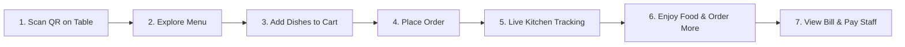

# 📱 InfoRyse — Customer Dining & Smart QR Ordering Guide
*A complete step-by-step walkthrough for diners, guests, and patrons.*

---

## 🌟 Introduction
Welcome to **InfoRyse**, the next-generation digital dining experience! When you visit an InfoRyse-powered restaurant, you don't need to wait for a physical menu card, wave down a waiter just to order another round of drinks, or calculate who ordered what at the end of the meal.

Everything is handled instantly from your phone’s browser:
- **No App Download**: Works directly in Safari, Chrome, Samsung Internet, or WhatsApp.
- **Zero Registration**: No phone sign-up or passwords required just to browse the menu.
- **Real-Time Shared Tab**: When you and your friends sit at the same table, you all see the same live order tab.
- **Live Kitchen Tracking**: Watch your food progress from kitchen prep to your table.

---

## 🍽️ The Complete Dining Journey (Step-by-Step)



---

### Step 1: Arriving at Your Table & Scanning the QR Code
1. Take your seat at your assigned table (e.g., **Table 04**).
2. Look at the stylish **InfoRyse QR stand** located at the center of your table.
3. Open your smartphone’s default camera app:
   - **iPhone (iOS)**: Open **Camera**, point at the QR code, and tap the yellow link banner that pops up.
   - **Android**: Open **Camera** or **Google Lens**, point at the QR code, and tap the link.
   - **Any Browser**: You can also scan using WhatsApp, Paytm, or Google Chrome's built-in QR scanner.
4. Your browser will instantly open your table's dedicated digital menu:
   ```
   https://your-restaurant.inforyse.com/r/restaurant-slug/qr-table-token
   ```
5. You will see the restaurant’s logo, banner, table number badge (e.g. `Table 04`), and today's active offers!

---

### Step 2: Exploring the Digital Menu
InfoRyse is designed for speed, clarity, and visual delight:

#### 1. Language Preference 🌐
- Look at the top right of your screen. Tap the language selector to switch the menu into your preferred language (English, Hindi, Kannada, Tamil, Arabic, etc.). All dish descriptions and buttons will adapt immediately.

#### 2. Veg / Non-Veg Filtering 🟢🔴
- Tap the **Veg** filter button to immediately hide all meat and seafood dishes if you prefer vegetarian food.
- Green icons (🟢) denote pure vegetarian items; red icons (🔴) denote non-vegetarian dishes.

#### 3. Category Carousel 🍲
- Swipe horizontally across the top category chips: **Breakfast, Starters, Main Course, Breads & Rice, Desserts, Beverages**.
- Tapping any category automatically scrolls straight to that section.

#### 4. Instant Search 🔍
- Tap the search bar and type dish names like *"Paneer"*, *"Biryani"*, or *"Ice Cream"*. Dishes update instantly as you type.

#### 5. High-Resolution Visuals & Badges ⭐
- Every dish card displays an authentic, high-resolution photo cleanly framed without distorting your screen.
- Look out for special badges on dish cards:
  - **⭐ Bestseller**: The restaurant's most-ordered specialty.
  - **🔥 Popular**: A crowd favorite with rave reviews.
  - **👨‍🍳 Chef's Pick**: Specially recommended by the head chef.
  - **✨ Today's Special**: Fresh seasonal preparation available today.

#### 6. Fast Browsing & "Load More Dishes"
- To keep your phone battery high and data usage low, the menu loads dishes smoothly in fast batches. If you reach the bottom of the section, simply tap **"Load More Dishes"** to view more.

---

### Step 3: Customizing & Adding Items to Your Cart
1. When you spot a dish you want, tap the green **+ ADD** button.
2. The button will transform into a quantity counter `− 1 +`:
   - Tap **+** to increase the quantity (e.g., 2 plates).
   - Tap **−** to decrease or remove the item.
3. At the bottom of your screen, a floating **Cart Bar** will appear showing your total selected items and subtotal (e.g., `2 Items · ₹380`).

---

### Step 4: Reviewing Your Cart & Submitting Your Order
1. Tap the floating **View Cart** bar or the **Cart** icon in the bottom navigation.
2. You will be taken to your Cart Review screen:
   - **Review Items**: Check each dish, quantity, and price.
   - **Cooking Instructions / Special Requests**: In the notes box, write any preferences (e.g., *"Make it less spicy"*, *"Extra chutney please"*, or *"No onions"*).
   - **Guest Details (Optional)**: Enter your Name and Phone Number so the restaurant staff can address you politely and send your digital receipt.
3. Tap **Place Dine-In Order** 🚀.
4. Your order is transmitted to the restaurant's kitchen display and cashier panel in under **500 milliseconds**.

---

### Step 5: Live Order Tracking (Kitchen Status)
Once submitted, your screen displays the **Live Order Status Card**:
- 🟡 **Waiting for Kitchen**: Order received, waiting for the chef to accept.
- 🔵 **Accepted**: Kitchen staff has acknowledged your order.
- 🟣 **Cooking in Kitchen**: The chef is actively preparing your dishes.
- 🟢 **Ready to Serve! 🎉**: Your food is plated and the server is bringing it to your table.
- ⚪ **Served ✓**: Food has arrived at your table. Enjoy your meal!

---

### Step 6: The Shared Table Tab (Ordering with Friends & Family) 👥
One of the best features of InfoRyse is **Shared Table Sessions**:
- **Everyone Can Order from Their Own Phone**: Your friend or family member at the same table can also scan the QR code with their phone.
- **Round-by-Round Visibility**: In the Cart page, tap the **"Confirmed Orders"** tab. You will see:
  - **Round 1**: Starters & drinks ordered 15 minutes ago.
  - **Round 2**: Main course ordered 5 minutes ago.
  - **Round 3**: Dessert or coffee ordered just now.
- No confusion about what has already been ordered, and no double orders!

---

### Step 7: Requesting Staff Assistance
Need extra napkins, a water bottle, or the bill? You don’t need to shout across the room:
- Look at the bottom navigation bar:
  - 💧 **Water Bottle**: Tap to notify staff that your table needs fresh drinking water.
  - 🔔 **Call Waiter**: Tap to request a server to attend to your table.
- A discreet notification chime instantly alerts the waiter and manager dashboard with your table number.

---

### Step 8: Settling Your Bill
1. When you have finished dining, tap **Cart** ➔ **Confirmed Orders** to review your finalized table tab.
2. The tab shows your itemized breakdown, applicable discounts, and GST taxes.
3. The restaurant captain will bring your official printed thermal bill to your table.
4. Pay conveniently via **Cash, UPI QR, or Credit/Debit Card**.
5. Once marked paid by the cashier, your table session closes automatically.
6. When the next guest sits down at that table, the table starts completely fresh and clean!

---

## 💡 Quick Tips for Diners
> [!TIP]
> **Accidental Tab Close?** Don't worry! If your browser tab closes or your battery dies, simply re-scan the table QR code. All your placed orders and table tab will restore immediately.

> [!NOTE]
> **Unsubmitted Cart Items**: Dishes kept in your cart but never submitted (never tapped "Place Order") will NOT be charged to your bill. Only placed orders enter the kitchen system.
