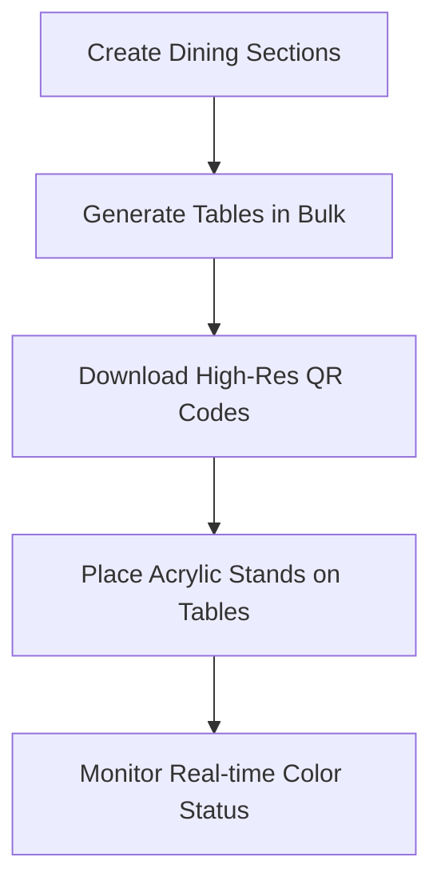
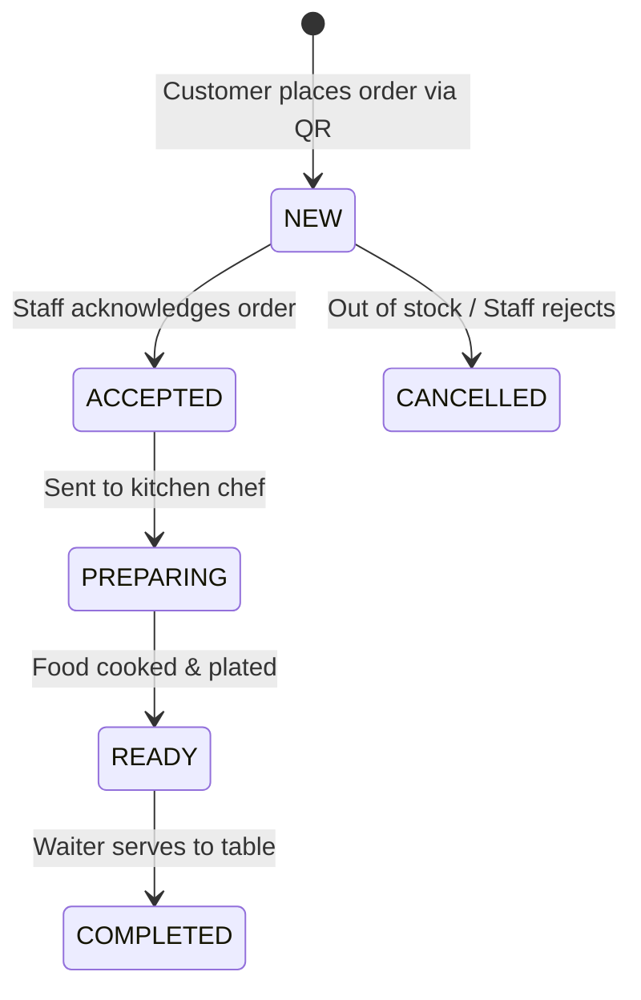

# 🏪 InfoRyse — Restaurant Partner & Staff Operations Manual
*Complete operational guide for Restaurant Owners, General Managers, Cashiers, and Kitchen Captains.*

---

## 📋 Executive Onboarding Checklist (What to Do First)
Follow this prioritized checklist when setting up your restaurant on InfoRyse for the first time:

| Step | Action | Page / Section | Time Required |
| :--- | :--- | :--- | :--- |
| **1** | First Login & Password Setup | `/admin/login` | 2 minutes |
| **2** | Restaurant Profile & Tax/GST Setup | `/admin/profile` | 5 minutes |
| **3** | Create Dining Sections & Generate Tables | `/admin/tables` | 5 minutes |
| **4** | Download & Print Table QR Stands | `/admin/tables` | 10 minutes |
| **5** | Set Up Menu Categories & Dishes | `/admin/menu` | 20 minutes |
| **6** | Test a Demo Order & Kitchen Chime | `/admin/orders` | 3 minutes |
| **7** | Test Table Bill Settlement & Thermal Print | `/admin/bill` | 2 minutes |
| **8** | Add Staff Accounts | `/admin/staff` | 5 minutes |

---

## 🔐 Phase 1: First Login & Mandatory Security Setup

### 1. Access the Administrative Portal
- Open your browser (Google Chrome, Safari, or Microsoft Edge) and navigate to:
  ```
  https://your-domain.com/admin/login
  ```
- Enter your registered **Email Address** and the **Temporary Password** provided by the Super Administrator.
- Tap **Continue to Dashboard**.

### 2. Mandatory First-Time Password Change
- Because initial passwords are created as temporary credentials, InfoRyse enforces a **Mandatory Security Screen** on your first sign-in.
- Enter your **New Permanent Password** (minimum 8 characters).
- Confirm the new password and submit.
- Your session is immediately secured, and you are directed into your live Restaurant Dashboard.

---

## ⚙️ Phase 2: Restaurant Profile, Branding & Tax Configuration
Navigate to **Restaurant Profile** (`/admin/profile`) from the left sidebar navigation:

### 1. Basic Details & Operating Hours
- **Restaurant Name**: The public-facing trading name of your establishment.
- **Tagline**: e.g. *"Fine Dining & Authentic Taste"*.
- **Contact Number & Address**: Displayed on all printed thermal receipts and digital invoices.
- **Open Now Toggle**: Use this switch to open or close your digital ordering system. If toggled to **Closed**, customers scanning the QR code cannot place orders.

### 2. Visual Branding (Logo & Covers)
- **Restaurant Logo**: Upload your high-resolution brand logo. It appears on the customer QR landing page, cart header, and printed receipts.
- Automatically cropped and optimized to ensure ultra-fast loading on mobile networks.

### 3. Tax & Billing Settings (GST & Service Charge)
- **Tax Name**: e.g., `GST`, `VAT`, or `Sales Tax`.
- **Tax Percentage (%)**: Set your standard tax percentage (e.g. `5%` for restaurants).
- InfoRyse will automatically compute this line item on customer checkout and finalized billing tabs.

### 4. Discounts & Promotional Offers
- **Discount Active**: Enable or disable ongoing store-wide promotions.
- **Discount Percentage (%)**: e.g. `10%` off during Happy Hours or Grand Opening.
- **Discount Campaign Title**: e.g., `Grand Opening Celebration`.

---

## 🪑 Phase 3: Table Management & QR Code Deployment
Navigate to **Table Management** (`/admin/tables`):



### 1. Organizing Dining Sections
Organize your establishment into physical dining zones:
- `Indoor AC Dining`
- `Open Terrace / Rooftop`
- `Family Hall`
- `Garden / Patio`

### 2. Bulk Table Generation
Instead of adding tables one by one:
1. Tap **Generate Tables** at the top right.
2. Select the **Section** (e.g., `Indoor AC`).
3. Enter the **Count** of tables to generate (e.g., `10`).
4. Click **Create Tables**. Tables `Table 01` through `Table 10` are instantly provisioned with unique, cryptographic QR tokens.

### 3. Downloading & Printing Table QR Codes
1. Click on any table card to open the **Table Details Drawer**.
2. Tap **Download QR (PNG)** for individual high-res PNG image.
3. Tap **Print All QR Codes** to generate a pre-formatted print sheet ready for physical acrylic table stands or laminated stickers.

### 4. Real-Time Table Status Indicators
InfoRyse tables reflect real-time live statuses across your restaurant:
- 🟢 **AVAILABLE (Green)**: The table is completely clear, vacant, and ready for new guests.
- 🔴 **OCCUPIED (Red)**: Guests are currently seated and have active food orders running in the kitchen.
- 🟡 **RESERVED (Yellow)**: The table has been marked for an incoming reservation.
- ⚫ **OUT OF SERVICE (Grey)**: Under maintenance or cleaning.

---

## 🍽️ Phase 4: Menu Architecture & Catalog Management
Navigate to **Menu Management** (`/admin/menu`):

### 1. Categories
- Add or quick-pick categories: *Breakfast, Starters, Main Course, Breads & Rice, Hot Beverages, Cold Drinks, Desserts*.
- Re-order categories to determine which section appears first on customer smartphones.

### 2. Adding & Editing Menu Dishes
Tap **+ Add New Item** to open the creation panel:
1. **Dish Photo Upload**:
   - Tap **Upload dish photo** (supports JPEG, PNG, WebP up to 5MB).
   - InfoRyse automatically centers, bounds, and renders the image without bulging or distorting layouts on admin or customer screens.
2. **Item Name**: e.g., *Paneer Butter Masala* or *Crispy Chicken Burger*.
3. **Price in Rupees (₹)**: e.g., `280`.
4. **Category**: Assign the dish to its relevant category.
5. **Dietary Classification**:
   - 🟢 **Veg**: Renders the green vegetarian badge on digital cards.
   - 🔴 **Non-Veg**: Renders the red non-veg badge on digital cards.
6. **Marketing Badges**:
   - ⭐ **Bestseller**: Drives maximum customer attention.
   - 🔥 **Popular**: Highlight favorite dishes.
   - 👨‍🍳 **Chef's Pick**: Special recommendations.
   - ✨ **Today's Special**: Highlight fresh preparations.

### 3. Quick Sold-Out / Availability Toggle
- During busy lunch or dinner rush hours, ingredients may run out.
- In `/admin/menu`, simply tap the **● Available / ○ Unavailable** button on any dish card.
- The dish immediately greys out on all customer smartphones in real-time, preventing customers from ordering sold-out items!

---

## 📦 Phase 5: Kitchen Display & Live Orders Flow
Navigate to **Orders** (`/admin/orders`):

### 1. Real-Time Audio Notifications & Zero-Delay Stream
- When any customer at any table places an order, your dashboard:
  - Plays an audible kitchen notification chime 🔔.
  - Inserts the new order card at the top of the queue with an animated pulse.
  - Displays the exact **Table Number**, **Customer Name**, **Order Number**, and timestamp.

### 2. Managing the Order Lifecycle



1. **🟡 NEW (Waiting)**:
   - Order received from table. Review special notes (e.g. *"Less spicy"*).
   - Tap **Accept Order**.
2. **🔵 ACCEPTED**:
   - Kitchen acknowledges the ticket.
   - Tap **Start Cooking**.
3. **🟣 PREPARING (In Kitchen)**:
   - Chefs are actively preparing the dishes.
   - Tap **Mark Ready**.
4. **🟢 READY TO SERVE**:
   - Food is plated on the pass. Sound notification alerts the service waiters.
   - Server takes food to the table.
   - Tap **Mark Served**.
5. **⚪ COMPLETED**:
   - Food successfully delivered to diners.

---

## 🧾 Phase 6: Table Billing, Settle Payment & Release Table
Navigate to **Table Bill** (`/admin/bill`):

### 1. Consolidated Multi-Round Running Tabs
- When a group sits at **Table 02**, they may order 3 separate rounds:
  - Round 1: Soups and Mocktails.
  - Round 2: Main Course & Naan.
  - Round 3: Ice Cream & Coffee.
- The **Table Bill panel automatically consolidates all rounds** into one unified, itemized master bill:
  - Combines identical items (e.g., 2 Naans from Round 1 + 3 Naans from Round 2 = **5× Butter Naan**).
  - Automatically calculates Subtotal, active Restaurant Discounts, Tax/GST, and Packing/Service Charges.

### 2. Settling the Bill & Printing Thermal Receipt
1. Select the occupied table (e.g., **Table 02**) from the left table list.
2. Review the aggregated dishes and grand total.
3. Tap **Settle Payment & Close Table**:
   - Choose the Payment Method: **CASH**, **UPI QR**, **CARD**, or **OTHER**.
   - Enter guest name or phone number if requested for digital records.
   - Tap **Confirm Payment & Print Bill**.
4. The system opens the **Thermal POS Print Dialog** (formatted for 80mm/58mm standard thermal receipt printers) with your restaurant logo, GST number, bill number, table number, and breakdown.
5. **What happens automatically in the background**:
   - The bill is permanently saved in the immutable **Payment History**.
   - All orders on that table session are marked **COMPLETED**.
   - The table session is finalized and closed.
   - The table is automatically restored to **🟢 AVAILABLE (Green)**.
   - When a new customer arrives at Table 02 and scans the QR code, they receive a **fresh, empty table tab** with zero collision from the previous diners!

---

## 💰 Phase 7: Payment History & Revenue Auditing
Navigate to **Payment History** (`/admin/payments`):

- **Executive Revenue Metrics**:
  - Total Revenue Settled (₹).
  - Total Settled Bills Count.
  - Average Ticket Size per Table.
- **Search & Filters**:
  - Filter by Payment Method: Cash, UPI, Card.
  - Instant search by Bill Number (e.g. `#1042`), Table Number, or Customer Phone.
- **Thermal Re-Printing**:
  - Need to reprint a bill from earlier today? Tap the **Printer** icon next to any historical bill to reprint immediately.
- **Export to CSV**:
  - Tap **Export All CSV** to download a spreadsheet of all transactions for your accountant or tax filing.

---

## 👥 Phase 8: Staff Accounts & Role Permissions
Navigate to **Staff Management** (`/admin/staff`):

1. Tap **Add Staff Member**.
2. Enter Name, Email, Role (`STAFF` or `MANAGER`), and assign a temporary password.
3. **Staff Access Restrictions**:
   - Staff members can access Live Orders, Kitchen Display, and Table Bill panels.
   - Settings, Financial Analytics, and Restaurant Profile are strictly restricted to the **OWNER**.

---

## 💡 Best Practices for Maximum Table Turnover
> [!TIP]
> **Keep Kitchen Screen Open**: Mount an iPad or low-cost tablet at the kitchen pass running `/admin/orders` with volume turned up. Chefs can tap **Ready** the instant dishes are plated!

> [!IMPORTANT]
> **Always Settle via Table Bill**: When customers pay, always use `/admin/bill` ➔ **Settle Payment & Close Table**. This ensures the table turns green (Available) and clears the digital QR session for incoming diners.
