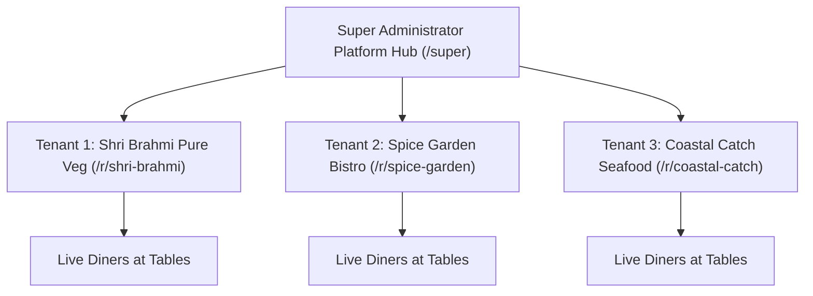
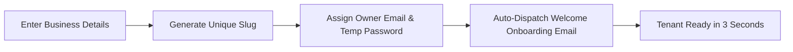

# 🛡️ InfoRyse — Super Administration & Multi-Tenant Governance Guide
*Master platform operational manual for System Administrators, Operations Directors, and Platform Owners.*

---

## 🌐 Overview & Multi-Tenant Architecture
**InfoRyse** is an enterprise-grade, multi-tenant Restaurant Operating System designed to power hundreds of independent dining establishments simultaneously from a single unified codebase.

Each restaurant functions inside a strictly isolated tenant bubble:
- **Tenant Isolation**: Restaurant A (`/shri-brahmi`) can never access or view data from Restaurant B (`/royal-palace`).
- **Cryptographic QR Tokens**: Tables use unique cryptographic UUID tokens preventing cross-table tampering.
- **Unified Master Hub**: The Super Administrator possesses complete visibility, orchestration, and security governance across all restaurants on the platform.



---

## 🔑 Phase 1: Super Admin Authentication
- **Portal URL**:
  ```
  https://your-domain.com/super/login
  ```
- **Security Protocols**:
  - The Super Admin portal is protected with `SUPERADMIN` role authorization in the database.
  - Non-superadmin users attempting to access `/super` routes are rejected with an immediate 403 Forbidden redirection.
  - Sessions use encrypted HTTP-only `inforyse_session` cookies with tamper-proof signatures.

---

## 📊 Phase 2: Command Center & Real-Time Analytics
Navigate to **Super Dashboard** (`/super/dashboard`):

### Platform KPI Metrics
- **Total Partner Restaurants**: Count of all onboarded food businesses on the platform.
- **Active Operational Tenants**: Restaurants currently marked active and open for dining.
- **Gross Merchandise Value (GMV)**: Cumulative revenue processed across all restaurants on the platform in INR (₹).
- **Total Orders Fulfilled**: Aggregate count of all confirmed dining tickets processed.
- **Average Order Value (AOV)**: Benchmark spending across all partner venues.

---

## 🚀 Phase 3: Onboarding a New Restaurant Partner
Navigate to **Restaurants** (`/super/restaurants`):

### 1. Launch the Onboarding Wizard
Tap **+ Register New Restaurant** to launch the multi-tenant provisioning modal:



### 2. Required Onboarding Fields
1. **Restaurant Business Name**: e.g., `Spice Symphony Fine Dine`.
2. **URL Identifier (Slug)**:
   - System automatically generates a clean URL slug (e.g. `spice-symphony`).
   - This defines the public QR ordering domain: `https://your-domain.com/r/spice-symphony/...`.
3. **Owner Full Name**: e.g., `Rajesh Kumar`.
4. **Owner Email Address**: e.g., `rajesh@spicesymphony.com`.
   - *This will be their primary login credential for `/admin/login`.*
5. **Temporary Access Password**:
   - The system generates an 8-character secure alphanumeric password (e.g. `Welcome@852`).
   - The owner will be forced to change this upon their first login.
6. **Dining Information**:
   - Contact Phone Number.
   - Physical City & Address.
   - Initial Table Count (e.g. 15 tables automatically pre-provisioned).

### 3. Automated Onboarding Email Dispatch
Upon clicking **Create & Provision Restaurant**:
- The platform provisions the database tenant records and default categories in one atomic transaction.
- An executive onboarding email is automatically generated and dispatched via SMTP directly to the restaurant owner's inbox.
- The email includes:
  - Restaurant Name & Slug.
  - Portal Login URL (`/admin/login`).
  - Login Email & Temporary Password.
  - Security warning advising them to set their permanent password upon first sign-in.

---

## 🔒 Phase 4: Tenant Governance & Instant Suspension
Navigate to **Restaurants** (`/super/restaurants`):

### 1. Suspending / Blocking a Delinquent Restaurant
If a restaurant fails to pay their monthly SaaS subscription or violates platform guidelines:
1. Locate the restaurant card or row in `/super/restaurants`.
2. Tap the **Status Toggle** or **Actions Menu** ➔ **Suspend Tenant**.
3. Confirm the suspension.

### 2. Immediate Security Lockout Behavior
The instant a restaurant is marked `isActive = false`:
- **Admin Panel Blocked**: Any logged-in restaurant owner or staff attempting to navigate `/admin` is immediately intercepted by the full-screen **Access Suspended** barrier:
  > *"Restaurant Access Suspended: Your operational portal and live ordering services are paused by Super Administration."*
- **QR Menus Deactivated**: Customers scanning table QR codes are shown:
  > *"This restaurant is currently unavailable."*
- **Live Ordering Halted**: All incoming API requests from this tenant are blocked with `403 Forbidden`.

### 3. Re-Activating a Restaurant
- Once billing is resolved, tap **Activate Tenant**.
- Within 1 second, all admin panels, staff devices, and customer QR menus resume operational status immediately without requiring app restarts or re-installs.

---

## 📦 Phase 5: Global Orders & Live Traffic Monitoring
Navigate to **Orders Stream** (`/super/orders`):

- **Real-Time Global Feed**: View orders streaming in across all restaurants in your city or region.
- **Inspect Tickets**: View item breakdowns, table numbers, timestamps, and customer payment methods.
- **Filter by Venue**: Inspect orders for a specific restaurant to assist in customer support inquiries or order disputes.

---

## 🛡️ Phase 6: Security Audit Logging & Compliance
Navigate to **Audit Logs** (`/super/audit-logs`):

InfoRyse maintains an immutable audit trail for complete accountability:
- **Timestamp**: Exact millisecond timestamp of every action.
- **Actor**: Which Super Admin or System process initiated the event.
- **Action Type**:
  - `RESTAURANT_CREATED`
  - `RESTAURANT_SUSPENDED`
  - `RESTAURANT_ACTIVATED`
  - `PASSWORD_RESET_FORCED`
  - `CONFIG_CHANGED`
- **Target**: Restaurant slug and ID affected.
- **IP Address & Client User Agent**: Cryptographic tracking for enterprise security audits.

---

## ⚙️ Phase 7: Infrastructure, Email & Storage Configuration

### 1. Email Service & Preventing Spam Folder Delivery
The platform delivers transactional emails (Password Resets, Onboarding Credentials, System Alerts).

#### Why Emails Can Land in Spam & How to Ensure 100% Inbox Delivery:
When sending via Google SMTP (`smtp.gmail.com`) using a custom domain (e.g. `superadmin@inforyse.com`), receiving servers (Gmail, Outlook, Yahoo) verify domain authenticity via **DNS records**.

To guarantee emails land in the **Primary Inbox**:
1. **Add SPF Record to DNS**:
   - In your domain DNS manager (Cloudflare, GoDaddy, Namecheap) for `inforyse.com`, add a TXT record:
     - **Type**: `TXT`
     - **Name / Host**: `@`
     - **Value**: `v=spf1 include:_spf.google.com ~all`
2. **Add DKIM Record in Google Workspace**:
   - Google Admin Console ➔ Apps ➔ Google Workspace ➔ Gmail ➔ Authenticate email ➔ Generate DKIM Record ➔ Add TXT record to domain DNS.
3. **Gmail App Password Setup**:
   - Go to Google Account Security (`https://myaccount.google.com/apppasswords`).
   - Create a 16-character App Password for "Mail".
   - Put `SMTP_PASS="xxxx xxxx xxxx xxxx"` in your `.env` file.
   - The platform automatically attaches anti-spam headers (`X-Priority: 1`, `Auto-Submitted: auto-generated`) and multi-part plain text alternatives to ensure high deliverability scores.

### 2. Database Session Pooler (Supabase PostgreSQL)
- InfoRyse uses Supabase managed PostgreSQL.
- **DATABASE_URL**: Uses port `5432` with session pooler mode (`aws-0-ap-southeast-1.pooler.supabase.com:5432`).
- This allows full support for Prisma prepared statements, transactions (`db.$transaction`), and high-concurrency table ordering without connection exhaustion.

### 3. Image Storage (Cloudflare R2 / Server Uploads)
- Menu dish photos, restaurant logos, and promotional banners are stored securely with automated size optimization.
- Files are bounded and delivered through high-speed CDN edges to ensure zero delay on customer mobile networks.

---

## 🎯 Super Admin Support & Operations Checklist
> [!TIP]
> **Daily Morning Check**: Open `/super/dashboard` to verify that all partner restaurants have their active status enabled and that the real-time event pipeline is responsive.

> [!IMPORTANT]
> **Credential Security**: Never share Super Admin credentials over chat. Each platform administrator should have their own individual account recorded in `/super/users`.
